<div align="center">

<a href="https://github.com/ishandutta2007/Awesome-Awesome-Awesome"></a><a href="https://discord.gg/jc4xtF58Ve"></a>
<a href="https://github.com/ishandutta2007/Awesome-Digital-Sculpting-Medical-3D-Modeling/stargazers"></a>
<a href="https://github.com/ishandutta2007/Awesome-Digital-Sculpting-Medical-3D-Modeling/network/members"></a>
<a href="https://github.com/ishandutta2007/Awesome-Digital-Sculpting-Medical-3D-Modeling/issues"></a>
<a href="https://github.com/ishandutta2007/Awesome-Digital-Sculpting-Medical-3D-Modeling/blob/main/LICENSE"></a>
<a href="https://github.com/ishandutta2007"></a>

<br/><br/>

<a href="#readme">
  
</a>

# 🎨 Awesome Digital Sculpting & Medical 3D Modeling 🩺

### *A Curated Directory of Production Digital Sculpting Suites, Medical DICOM-to-STL Mesh Reconstruction, Dynamic Retopology, and Biomedical Geometry Engines*

[](https://github.com/ishandutta2007/Awesome-Digital-Sculpting-Medical-3D-Modeling/pulls)
[](https://github.com/ishandutta2007/Awesome-Digital-Sculpting-Medical-3D-Modeling/graphs/commit-activity)
[](https://github.com/ishandutta2007/Awesome-Awesome-Awesome)

</div>

---

## 📖 Overview & SEO Keywords

Welcome to **Awesome Digital Sculpting & Medical 3D Modeling**, the premier curated list tracking high-performance commercial SaaS platforms, standalone desktop studios, WebGL web tools, and open-source GitHub software for:
- **Digital Sculpting & Dynamic Topology**: Voxel remeshing, brush tessellation, multiresolution subdivision, clay sculpting, and 3D concepting.
- **Medical 3D Modeling & Healthcare Imaging**: CT / MRI DICOM volumetric segmentation, patient-specific anatomical reconstruction, surgical guide modeling, implant design, and biomedical 3D printing.
- **Mesh Optimization & Geometry Processing**: Quad retopology, field-aligned remeshing, Poisson surface reconstruction, Laplacian smoothing, and watertight Boolean operations.

*Keywords: digital sculpting, medical 3d modeling, DICOM to STL, 3D printing segmentation, voxel remeshing, mesh processing, surgical planning, anatomical 3D models, quad retopology, 3D Slicer, Blender sculpting, ZBrush alternatives, Open3D, PyVista.*

---

## 📑 Table of Contents

- [📊 Sector Overview & Market Dynamics](#-sector-overview--market-dynamics)
- [☁️ SaaS / Hosted & Commercial Platforms](#️-saas--hosted--commercial-platforms)
- [💻 Open-Source GitHub Projects](#-open-source-github-projects)
  - [⭐ Featured Ecosystem Projects (Ranked by Stars)](#-featured-ecosystem-projects-ranked-by-stars)
  - [🔬 Geometry Processing, Volumetrics & Biomedical Libraries](#-geometry-processing-volumetrics--biomedical-libraries)
- [🛠️ Architectural Blueprints & Pipelines](#️-architectural-blueprints--pipelines)
- [🤝 How to Contribute](#-how-to-contribute)
- [💖 Support & Sponsorship](#-support--sponsorship)
- [📈 Star History](#-star-history)
- [⚠️ Disclaimer](#️-disclaimer)

---

## 📊 Sector Overview & Market Dynamics

The global **3D digital asset, animation, and digital sculpting software market** is currently valued at approximately **$32B–$36B**, experiencing robust growth driven by gaming, VFX, digital twins, and XR headsets (projected 13–14% CAGR). Concurrently, the specialized **healthcare 3D imaging, surgical planning, and medical 3D printing software** sector represents an additional **$2.5B–$3.1B** high-margin market with double-digit clinical adoption.

- **Creative Digital Sculpting (Moderately Fragmented)**: While foundational creative sculpting workflows remain anchored around industry flagships like Maxon (ZBrush, Cinema 4D) and Autodesk, lower barriers to entry, GPU compute, and mobile Apple Pencil / WebGL developments have driven healthy fragmentation with independent tools (Nomad Sculpt, 3D-Coat, SculptGL, Shapelab).
- **Medical 3D Modeling (Moderately Concentrated)**: In contrast, clinical medical 3D segmentation and surgical design software is heavily concentrated among regulatory-compliant organizations (Materialise Mimics) due to rigorous FDA 510(k), CE-MDR Class IIa/IIb clearances, clinical liability, and medical validation overhead. However, academic medicine and hospital research rely universally on open-source stalwarts like 3D Slicer and InVesalius.

---

## ☁️ SaaS / Hosted & Commercial Platforms

All commercial digital sculpting and medical 3D modeling platforms below are presented with verified starting tier pricing, explicit free trial / free tier restrictions, and company valuation metrics (sorted descending by corporate scale).

| 🏢 Company / Platform | 💰 Market Valuation / Revenue | 🏷️ Starting Tier Pricing | ⏳ Free Tier Limits / Free Trial | 🚀 Key Capabilities |
| :--- | :--- | :--- | :--- | :--- |
| **[Autodesk (Mudbox)](https://autodesk.com)** | **Valuation: ~$62.75B Market Cap**<br>*(FY2025 Revenue: $6.13B)* | Discontinued for standalone purchase (~$85/mo prior; accessible via Maya/3ds Max suites or Autodesk Flex tokens at ~$3/day) | **30-day free trial**; complete toolset unlocked for evaluation with full export and texture painting functionality; free 1-year educational license for eligible students and educators | 3D digital sculpting and multi-channel texture painting software offering subdivision-level workflows, PTEX painting, and Maya/3ds Max interoperability. |
| **[Autodesk (Meshmixer)](https://meshmixer.com)** | **Valuation: ~$62.75B Market Cap**<br>*(FY2025 Revenue: $6.13B)* | Free forever ($0) | **Completely free permanently**; full access with no feature locks, no seat limits, and no export restrictions (legacy v3.5 freeware maintained by Autodesk for STL prep and mesh healing) | Freeware triangle-mesh cleanup, hollowing, support-generation, and organic sculpting utility widely adopted in dental, prosthetic, and 3D-printing preparation pipelines. |
| **[Maxon (ZBrush)](https://maxon.net)** *(Parent: Nemetschek SE)* | **Valuation: ~$7.8B Market Cap (€7.2B)**<br>*(Parent FY2025 Revenue: €1.19B / ~$1.24B)* | $49/mo (billed monthly) or $399/yr (~$33.25/mo billed annually) | **14-day free trial** via Maxon App with all features unlocked (ZBrush for iPad offers a permanent free tier restricted to 28 core brushes and disabled advanced exports) | Industry-standard digital sculpting and painting platform featuring DynaMesh, ZRemesher, Sculptris Pro, and multi-million-polygon brush workflows for film, games, and medical illustration. |
| **[Maxon (Cinema 4D & Maxon One)](https://maxon.net)** *(Parent: Nemetschek SE)* | **Valuation: ~$7.8B Market Cap (€7.2B)**<br>*(Parent FY2025 Revenue: €1.19B / ~$1.24B)* | $109/mo (Cinema 4D standalone) or $169/mo (Maxon One bundle) | **14-day free trial** via Maxon App offering full suite capabilities across Cinema 4D, Redshift, and ZBrush without credit card requirement upfront | Professional 3D modeling, volume-builder sculpting, and motion graphics suite featuring procedural MoGraph cloners, VDB volume meshing, and cloud asset libraries. |
| **[Maxon (Forger 3D)](https://maxon.net)** *(Parent: Nemetschek SE)* | **Valuation: ~$7.8B Market Cap (€7.2B)**<br>*(Parent FY2025 Revenue: €1.19B / ~$1.24B)* | $9.99/mo or $89.99/yr (integrated into ZBrush for iPad ecosystem) | **Free tier permanently available** on iPad with 28 sculpting brushes, Sculptris Pro, and ZRemesher enabled; file export options and advanced rendering restricted without subscription | Mobile-first 3D sculpting and polygonal modeling studio bringing ZBrush-inspired brushes, symmetry, and remeshing tools to iPadOS. |
| **[Materialise (Mimics Innovation Suite)](https://materialise.com)** | **Valuation: ~$360M Market Cap**<br>*(FY2024 Revenue: €267.6M / ~$285M)* | ~$4,000/yr starting base tier (academic/single-seat DICOM reconstruction quote; commercial/clinical custom quote) | **14-to-30 day evaluation trial** upon sales request; strictly restricted to non-clinical and non-commercial testing with time-locked software expiration; no public unconstrained tier | Clinical-grade medical 3D modeling and DICOM segmentation platform converting CT/MRI scans into anatomical 3D models, surgical guides, and implants. |
| **[Blender Studio](https://blender.org)** *(Blender Foundation)* | **Valuation: Non-Profit Foundation**<br>*(FY2025 Revenue: €5.71M / ~$6.1M)* | €11.50/mo (~$12.30/mo) for Studio subscription (core Blender app is $0 open-source) | **No free tier for Blender Studio platform** (training courses, masterclasses, and open-movie production assets require active subscription; underlying Blender software is 100% free with 0 limits) | Official cloud training, production asset repository, and open-movie platform supporting the development of open-source Blender and its Sculpt Mode ecosystem. |
| **[Shapelab (Leopoly)](https://shapelabvr.com)** | **Valuation: ~$10M–$15M Est.**<br>*(Est. Annual Revenue: ~$2.7M)* | $9.99/mo or $49.99/yr (Meta Quest Standalone); $64.99 perpetual (Steam PCVR) | **7-day free trial** on Shapelab Max standalone subscription; Shapelab Lite offers a lower-cost perpetual build ($14.99) capped with reduced Dyntopo and voxel resolution limits | VR and desktop polygon/voxel sculpting application enabling intuitive spatial 3D modeling, dynamic tessellation, and high-resolution mesh export. |
| **[Nomad Sculpt](https://nomadsculpt.com)** *(Hexanomad)* | **Valuation: Bootstrapped / Indie**<br>*(Est. Annual Revenue: ~$1M–$2M)* | $19.99 one-time purchase (iOS/Android mobile) / $35.00 one-time (Desktop) | **Free Web demo** (browser-based WebAssembly sculpt mode) and **Android free evaluation download** with unlimited sculpting time; exports (OBJ, STL, glTF, PLY) and project saving are fully disabled until licensed | High-performance portable digital sculpting and vertex-painting studio for iPad, Android, and desktop featuring voxel remeshing, dynamic topology, PBR rendering, and `.obj`/`.stl`/`.glb` export. |
| **[3D-Coat & 3D-Coat Print](https://3dcoat.com)** *(Pilgway)* | **Valuation: Private Independent**<br>*(Est. Annual Revenue: ~$1M–$3M)* | $20.90/mo (Individual subscription) or $439.00 perpetual license | **30-day fully functional free trial**; transitions to permanent **Free Learning Mode** capped at 20K sculpt triangles, 4K retopo polygons, and 512x512 textures; **3DCoatPrint** is permanently free with a 40,000 triangle export limit for 3D printing | Voxel-based digital sculpting, auto-retopology, UV mapping, and PBR texturing suite engineered for organic characters, hard-surface assets, and 3D-printable models. |

---

## 💻 Open-Source GitHub Projects

This expanded open-source section curates the finest open-source software, desktop suites, algorithms, and geometry libraries for digital sculpting, CT/MRI DICOM segmentation, and biomedical mesh reconstruction.

Each repository includes an official GitHub stargazers badge (`style=social`, `color=white`) linking directly to that repository's stargazers page, sorted in **descending order by star count**.

### ⭐ Featured Ecosystem Projects (Ranked by Stars)

1. **[Blender (`blender/blender`)](https://github.com/blender/blender)**  
   <a href="https://github.com/blender/blender/stargazers"></a>  
   Flagship open-source 3D creation suite featuring a high-performance Sculpt Mode with Dyntopo dynamic topology, Voxel and Quadriflow remeshing, multiresolution sculpting, cloth physics brushes, and complete Cycles/Eevee rendering pipelines.

2. **[Open3D (`isl-org/Open3D`)](https://github.com/isl-org/Open3D)**  
   <a href="https://github.com/isl-org/Open3D/stargazers"></a>  
   Modern open-source C++ and Python library for 3D data processing, point cloud registration, Poisson surface reconstruction from medical point scans, voxelization, and interactive anatomical mesh rendering.

3. **[Instant Meshes (`wjakob/instant-meshes`)](https://github.com/wjakob/instant-meshes)**  
   <a href="https://github.com/wjakob/instant-meshes/stargazers"></a>  
   Interactive field-aligned auto-retopology tool converting dense, unstructured sculpted meshes and raw biomedical scans into clean, animation-ready quad-dominant or pure-triangular topology.

4. **[CGAL (`CGAL/cgal`)](https://github.com/CGAL/cgal)**  
   <a href="https://github.com/CGAL/cgal/stargazers"></a>  
   Computational Geometry Algorithms Library providing robust C++ algorithms for 3D surface and volume mesh generation from 3D medical images (segmented MRI/CT), Alpha Shapes, subdivision, polygon mesh processing, and exact Boolean computations.

5. **[MeshLab (`cnr-isti-vclab/meshlab`)](https://github.com/cnr-isti-vclab/meshlab)**  
   <a href="https://github.com/cnr-isti-vclab/meshlab/stargazers"></a>  
   Renowned open-source desktop system for processing, cleaning, healing, decimating, filtering, smoothing, and inspecting large unstructured 3D triangular meshes and 3D medical scan point clouds.

6. **[libigl (`libigl/libigl`)](https://github.com/libigl/libigl)**  
   <a href="https://github.com/libigl/libigl/stargazers"></a>  
   Header-only C++ and Python geometry processing library offering discrete differential geometry, Laplacian mesh editing, harmonic coordinates, geodesics, parameterization, and robust mesh booleans.

7. **[PyVista (`pyvista/pyvista`)](https://github.com/pyvista/pyvista)**  
   <a href="https://github.com/pyvista/pyvista/stargazers"></a>  
   Streamlined Pythonic interface to the Visualization Toolkit (VTK), widely utilized for programmatic anatomical surface manipulation, surgical slicing, CT isosurface generation, and publication-ready medical 3D visualization.

8. **[Trimesh (`mikedh/trimesh`)](https://github.com/mikedh/trimesh)**  
   <a href="https://github.com/mikedh/trimesh/stargazers"></a>  
   Pure Python library for loading, manipulating, checking watertightness, slicing cross-sections, and computing convex hulls and volume properties on 3D triangular meshes and medical STL/OBJ files.

9. **[Dust3D (`huxingyi/dust3d`)](https://github.com/huxingyi/dust3d)**  
   <a href="https://github.com/huxingyi/dust3d/stargazers"></a>  
   Lightweight, cross-platform 3D modeling and base-mesh generator allowing artists and modelers to create watertight, auto-rigged, and UV-unwrapped organic models from 2D sketches and skeletal nodes in seconds.

10. **[three-mesh-bvh (`gkjohnson/three-mesh-bvh`)](https://github.com/gkjohnson/three-mesh-bvh)**  
    <a href="https://github.com/gkjohnson/three-mesh-bvh/stargazers"></a>  
    High-performance Bounding Volume Hierarchy (BVH) spatial indexing for Three.js enabling real-time browser-based mesh sculpting, raycasting, interactive surgical collision detection, and dynamic mesh carving.

11. **[OpenVDB (`AcademySoftwareFoundation/openvdb`)](https://github.com/AcademySoftwareFoundation/openvdb)**  
    <a href="https://github.com/AcademySoftwareFoundation/openvdb/stargazers"></a>  
    Academy Award-winning hierarchical data structure and suite of C++ tools for efficient storage and manipulation of sparse volumetric data discretized on three-dimensional grids—powering modern voxel sculpting engines and fast level-set booleans.

12. **[VTK (`Kitware/VTK`)](https://github.com/Kitware/VTK)**  
    <a href="https://github.com/Kitware/VTK/stargazers"></a>  
    The Visualization Toolkit: foundational C++ software system for 3D computer graphics, volume rendering, contour extraction (Marching Cubes), and biomedical image processing powering nearly every major clinical research application.

13. **[OpenSubdiv (`PixarAnimationStudios/OpenSubdiv`)](https://github.com/PixarAnimationStudios/OpenSubdiv)**  
    <a href="https://github.com/PixarAnimationStudios/OpenSubdiv/stargazers"></a>  
    Pixar's open-source high-performance subdivision surface evaluation library running on multi-core CPU and GPU architectures, utilized in digital sculpting for smooth limit-surface evaluation.

14. **[3D Slicer (`Slicer/Slicer`)](https://github.com/Slicer/Slicer)**  
    <a href="https://github.com/Slicer/Slicer/stargazers"></a>  
    The definitive open-source platform for medical image computing, surgical navigation, CT/MRI DICOM segmentation, segment editor manual sculpting brushes, and patient-matched STL reconstruction for 3D printing.

15. **[Manifold (`elalish/manifold`)](https://github.com/elalish/manifold)**  
    <a href="https://github.com/elalish/manifold/stargazers"></a>  
    Blazing-fast modern C++/WASM geometry library guaranteeing watertight, topologically valid 2-manifold polygon mesh booleans, collision verification, and surgical implant design operations.

16. **[libfive (`libfive/libfive`)](https://github.com/libfive/libfive)**  
    <a href="https://github.com/libfive/libfive/stargazers"></a>  
    Infrastructure for generative digital sculpting and solid modeling with Signed Distance Fields (SDF) and functional representations (F-rep), delivering infinite-resolution organic blending without polygon meshing artifacts.

17. **[SculptGL (`stephomi/sculptgl`)](https://github.com/stephomi/sculptgl)**  
    <a href="https://github.com/stephomi/sculptgl/stargazers"></a>  
    Pioneering open-source WebGL digital sculpting web application supporting dynamic subdivision (Dyntopo), voxel remeshing, PBR matcaps, symmetry, and `.obj`/`.stl`/`.ply` export right in the web browser.

18. **[Bforartists (`Bforartists/Bforartists`)](https://github.com/Bforartists/Bforartists)**  
    <a href="https://github.com/Bforartists/Bforartists/stargazers"></a>  
    Complete fork of Blender tailored for digital artists with an intuitive, icon-centric graphical UI that streamlines access to Blender's powerful 3D sculpting, brushing, and remeshing toolset.

19. **[InVesalius 3 (`invesalius/invesalius3`)](https://github.com/invesalius/invesalius3)**  
    <a href="https://github.com/invesalius/invesalius3/stargazers"></a>  
    Open-source medical imaging and 3D reconstruction software generating patient-specific virtual anatomical models from CT and MRI DICOM slices for surgical pre-planning, prosthetic design, and 3D printing.

20. **[ITK-SNAP (`pyushkevich/itksnap`)](https://github.com/pyushkevich/itksnap)**  
    <a href="https://github.com/pyushkevich/itksnap/stargazers"></a>  
    Interactive open-source biomedical image tool providing semi-automatic active contour (snake) 3D segmentation, manual 3D brush sculpting across orthogonal volumetric slices, and STL/VTK surface export.

---

### 🔬 Geometry Processing, Volumetrics & Biomedical Libraries

- **[Orthanc (`orthanc-server/orthanc`)](https://github.com/orthanc-server/orthanc)** — Lightweight, RESTful self-hosted open-source DICOM server storing and routing CT/MRI studies directly into 3D Slicer and InVesalius pipelines.
- **[islandmed/sculptforge](https://github.com/ishandutta2007/Awesome-Digital-Sculpting-Medical-3D-Modeling)** — Digital sculpting and anatomical mesh refining utilities bridging surgical planning with 3D print mesh validation.
- **[SimpleITK (`SimpleITK/SimpleITK`)](https://github.com/SimpleITK/SimpleITK)** — Simplified programming layer over the Insight Segmentation and Registration Toolkit (ITK) for automated biomedical image thresholding and filtering.
- **[TetGen (`libigl/tetgen`)](https://github.com/libigl/tetgen)** — Quality tetrahedral mesh generator and 3D Delaunay triangulator generating volumetric finite element meshes (FEA) from patient organ surfaces.

---

## 🛠️ Architectural Blueprints & Pipelines

Combine these tools to build end-to-end production pipelines:

```
[CT / MRI Scan] 
       │ (DICOM Slices)
       ▼
[Orthanc Server] ────► [3D Slicer / InVesalius 3 / ITK-SNAP]
                             │ (Segmented Labelmap / Marching Cubes)
                             ▼
                    [Raw Anatomical Mesh (.STL/.OBJ)]
                             │
       ┌─────────────────────┴─────────────────────┐
       ▼                                           ▼
[Blender Sculpt Mode / SculptGL]       [Instant Meshes / Manifold]
• Organic brush sculpting               • Clean Quad-dominant remeshing
• Defect repair & smoothing             • Watertight boolean cuts & surgical guides
• Texture painting                      • Finite Element Analysis (FEA) prep
       │                                           │
       └─────────────────────┬─────────────────────┘
                             ▼
              [Validated Medical 3D Model]
                             │
              ┌──────────────┴──────────────┐
              ▼                             ▼
   [Clinical 3D Printing]       [Surgical AR/VR Simulation]
   (Biocompatible Resins/PEEK)  (Unity / Unreal / Three.js)
```

---

## 🤝 How to Contribute

Contributions are warmly welcomed! Please follow these steps to contribute new digital sculpting tools or medical 3D modeling engines:

1. 🍴 **Fork the repository** to your personal GitHub account.
2. 🌿 **Create a new branch** (`git checkout -b feature/add-tool-name`).
3. 📝 **Add your tool** following the existing format:
   - For SaaS: Platform name, link, valuation/revenue, pricing, explicit free trial/tier limits, and key capabilities.
   - For Open-Source: Name, GitHub repository link, star badge, and an informative 1–2 sentence description.
4. 📬 **Submit a Pull Request** with a clear description of why the tool is valuable for digital sculptors or biomedical engineers.

---

## 💖 Support & Sponsorship

If this curated repository saved you hours of research or helped you find the right software for your 3D digital art, biomedical engineering, or surgical planning project, please consider supporting the project!

- ⭐ **Star this repository** to improve its visibility for researchers and 3D artists.
- 🍴 **Fork and share** the repo on [LinkedIn](https://linkedin.com), [X/Twitter](https://x.com), and Reddit.
- ☕ **Sponsor on GitHub Sponsors**: You can buy me a coffee or support ongoing open-source maintenance directly through my [GitHub Sponsor Dashboard](https://github.com/sponsors/ishandutta2007). Your sponsorship helps keep these ecosystem directories up-to-date and thoroughly vetted!

<br/>

<div align="center">

<a href="https://github.com/sponsors/ishandutta2007">
  
</a>

</div>

---

## 📈 Star History

[](https://www.star-history.com/#ishandutta2007/Awesome-Digital-Sculpting-Medical-3D-Modeling&type=date&legend=top-left)

---

## ⚠️ Disclaimer

- **Community Curated**: This list is independently curated for educational and informational purposes. It is not an endorsement of any particular commercial vendor or clinical tool.
- **Medical & Clinical Safety Notice**: Open-source medical 3D modeling tools (*3D Slicer, ITK-SNAP, InVesalius 3, MeshLab*) are intended for scientific research, visualization, and educational purposes. Unless specifically certified with FDA 510(k), CE-MDR, or local regulatory clearances in your jurisdiction, they must not be used as the sole basis for clinical diagnosis or surgical intervention without certified medical oversight.
- *Proprietary vs. Open-Source*: Note that Autodesk Meshmixer is proprietary freeware, whereas Blender, SculptGL, 3D Slicer, and others listed under the Open-Source section are governed by open-source licenses (GPL, BSD, Apache, MIT).
